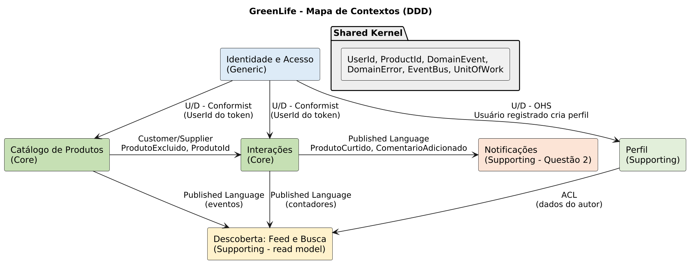

# Mapa de contextos

| Relação | Padrão | Observação |
|---|---|---|
| Identidade → Perfil | Upstream/Downstream, Open Host Service | `ContaRegistrada` cria o `Perfil` vazio |
| Identidade → Catálogo / Interações | Conformist | ambos usam o `UserId` vindo do token JWT |
| Catálogo → Interações | Customer/Supplier | Interações referencia `ProdutoId`; reage a `ProdutoExcluido` removendo curtidas e comentários |
| Catálogo, Interações, Perfil → Descoberta | Published Language (eventos) + ACL | Descoberta mantém projeções de leitura (feed, contadores, autor) |
| Interações → Notificações | Published Language via broker | Questão 2 |
| Todos | Shared Kernel | `UserId`, `ProductId`, `DomainEvent`, `DomainError`, portas `EventBus` e `UnitOfWork` |
